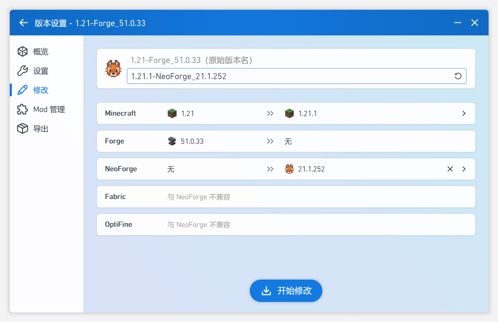

# PCL2-Enhanced

**Plain Craft Launcher 2 增强版** · An enhanced open-source edition of PCL2

> 基于官方 PCL2 2.99.0.0 源码（`6b9a50d`）改造的开源增强版启动器：修复游戏本体下载限制，新增版本升级、模组汉化、模组前置一键下载、模组购物车、截图中心、备份管理、皮肤绘制器等 21 项功能。
>
> Based on the official PCL2 2.99.0.0 source (`6b9a50d`): fixes the game-download restriction and adds 21 enhancements — version modify, mod localization, one-click dependency install, mod cart, screenshot center, backup manager, skin editor and more.

---

## ✨ 功能特性 / Features

### 一、实例管理与数据维护 / Instance Management & Data

| 功能 / Feature | 说明 / Description |
|---|---|
| 截图中心与跨实例同步 | 截图中心集中管理实例截图，支持跨实例同步备份 / Central screenshot center with cross-instance sync |
| 备份管理 | 实例世界、配置、模组一键备份与还原 / One-click backup & restore for worlds, configs and mods |
| 实例核心编辑与一键升级 | 修改/升级游戏核心（版本、加载器），解除下载限制后完整可用 / Edit & upgrade game core (version / loader); fully usable after the download-limit fix |
| 实例内筛选与数据包管理 | 实例内模组/资源筛选排序；数据包安装与管理 / In-instance filtering; data pack install & management |
| 实例图标生成器 | 一键生成实例专属图标 / One-click instance icon generator |
| 实例分组及关系图 | 实例分组管理，依赖关系图直观展示 / Instance grouping with dependency graph view |
| .minecraft 文件结构支持 | 完整支持 .minecraft 目录结构，版本隔离与文件管理 / Full .minecraft folder structure support with version isolation |

### 二、模组与资源生态 / Mods & Resource Ecosystem

| 功能 / Feature | 说明 / Description |
|---|---|
| 依赖项显示与依赖预览 | 安装模组时展示依赖项与依赖关系预览 / Dependency display & preview when installing mods |
| 模组购物车安装流程 | 多模组加入购物车，批量一键安装 / Cart-based batch mod installation |
| 模组匹配 MC 百科页面 | 模组详情一键跳转 MC 百科（MCBBS Wiki）/ Link to MCBBS Wiki page for each mod |
| Cleanroom 加载器支持 | 新增 Cleanroom 加载器安装引导，1.8.8 支持更多加载器 / Cleanroom loader installer guide; more loaders for 1.8.8 |
| CurseForge 地图安装 | 下载页新增“地图”分类，CurseForge/Modrinth 双源 / New “Maps” category with CurseForge & Modrinth sources |
| MC Archive 内容源 | 官方源与 BMCLAPI 均不可用时自动降级 MC Archive / Automatic fallback to MC Archive when official & BMCLAPI sources fail |
| 整合包安装优化 | 整合包安装流程优化 / Improved modpack installation |
| 模组收藏功能优化 | 模组收藏管理增强 / Enhanced mod favorites |

### 三、个性化与界面体验 / Personalization & UI

| 功能 / Feature | 说明 / Description |
|---|---|
| 皮肤绘制器与盔甲预览 | 内置像素皮肤编辑器（画笔/橡皮/填充/取色），铁/金/钻盔甲实时预览 / Built-in pixel skin editor with iron/gold/diamond armor preview |
| 收藏夹功能 | 实例收藏夹快速访问 / Instance favorites |
| 发现页卡片布局与模糊搜索 | 更多卡片布局；搜索框 450ms 防抖自动搜索 / More card layouts; debounced auto-search |
| 设置页存储管理 | 设置页内新增存储管理（数据/缓存目录）/ Storage manager inside Settings |
| 关于界面与实验室 UI | 关于界面与实验室页重构 / Redesigned About & Lab pages |
| 整体 UI 表现优化 | 全部新页面沿用 PCL2 原生动画与界面风格 / All new pages keep PCL2's native animations & UI style |

## 🛠 修复 / Fixes

- **修复游戏本体无法下载限制**：`Modules/ModSecret.vb` 中 `RestrictMcDownload` 已从 `True` 改为 `False`，官方源/BMLAPI/MC Archive 多源下载恢复可用 / Removed the game-download restriction (`RestrictMcDownload` → `False`), multi-source downloads restored.

## 🖼 截图 / Screenshot



## 🔨 编译 / Build

> Windows 环境 · .NET Framework 4.8 + Visual Studio 2022（需安装 **.NET Framework 4.8 Developer Pack** 与 **VS Build Tools / 工作负载：.NET 桌面开发**）

1. 打开 `Plain Craft Launcher 2.sln`（如直接 MSBuild，需按 WPF 任务宿主要求配置 `WinFX.targets` 导入与 `PresentationBuildTasks` UsingTask，见 `docs/build-notes.md`）
2. 还原 `PCLCS`、`MeloongCore` 项目引用
3. **Release** 配置编译（x64），产物为 `Plain Craft Launcher 2.exe`

> Windows build environment note: .NET Framework 4.8 Developer Pack + VS2022 Build Tools required. See `docs/build-notes.md` for the WPF build-task configuration used by the release pipeline.

## 🔑 CurseForge API Key（可选 / Optional）

开源版不内置 CurseForge API Key。PCL2 通过环境变量读取，无需改代码：

```bash
setx PCL_CURSEFORGE_API_KEY "your-key"
```

设置后重新启动 PCL2 即可。未设置时，CurseForge 请求自动降级，**Modrinth 源完全可用**（免 key）。申请 key：https://support.curseforge.com/de/support/solutions/articles/9000208346

> The open-source edition does not bundle a CurseForge API key. PCL2 reads it from the `PCL_CURSEFORGE_API_KEY` environment variable — no code change needed. Without a key, the Modrinth source (key-free) still works fully.

## 🙏 致谢 / Credits

- 上游项目：官方 [PCL2 / Plain Craft Launcher 2](https://github.com/Hex-Dragon/PCL2)（作者：龙腾猫跃 / LTCat）
- 汉化数据：CFPA 汉化资源包、MCBBS Wiki
- 模组数据：Modrinth API、CurseForge API

## 📄 许可 / License

本仓库基于官方 PCL2 源码改造，遵循上游《**PCL 分发有限许可**》（`LICENCE`）：https://shimo.im/docs/rGrd8pY8xWkt6ryW

> This repository is a modified build of the official PCL2 source and follows the upstream *PCL Limited Distribution License* (`LICENCE`).

---

**免责声明 / Disclaimer**：本仓库为第三方开源改造版，与官方 PCL2 无隶属关系；请勿将本改造版用于商业用途或违反上游许可条款。
